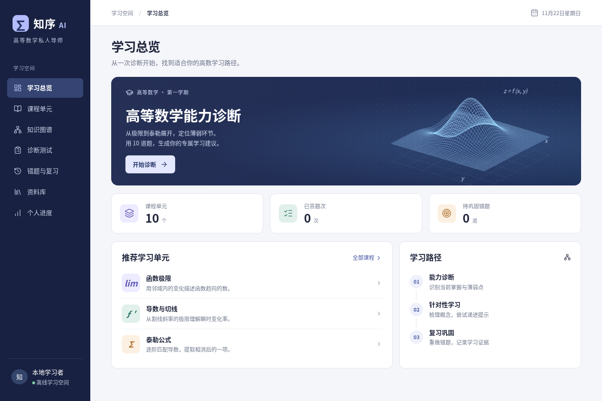

# 知序 AI · 高等数学私人导师

在本机完成第一学期高数的诊断、学习、纠错和复习。内置 10 个原创单元、10 道诊断题和 40 道分级练习。首次打开即可学习，无需账号或 API Key。



## Windows 便携版

下载 Windows x64 ZIP，选择「全部解压」，双击「知序AI.exe」。包内包含运行环境、符号计算库和前端。关闭「学习服务运行中」窗口即可退出。进度自动保存到当前用户的数据目录。

[Windows 发布包](https://github.com/liuxingdeyunff/-AI/releases/tag/v0.2.0-rc.2) · [中文使用说明](docs/Windows使用说明.md)

资料库可选本机 Ollama，也可显式配置自己的 DeepSeek 账户。云端密钥仅在本次运行内存中保存，发送材料或步骤前需要确认范围与费用。开启模型后可生成带逐段引用和建议先修的研读单元。离线模式支持解题步骤记录、方法追问、符号验证和自适应变式。

## 十分钟体验一次闭环

1. 打开资料库，导入随仓库提供的两页原创 PDF。切换到第 2 页，可看到 Peano 余项的原文和对应知识单元。点击「按此资料优先诊断」可优先测试材料中出现的知识点。[示例 PDF](examples/局部近似与相消.pdf)
2. 从首页「开始诊断」进入通用诊断。在正弦相消极限题中尝试输入 `0`。可以先看两级提示，提交后查看参考答案、建议排查的错因以及先修讲义。离开未完成的诊断后，可继续剩余题目。
3. 浏览知识图谱，点击节点进入学习页。泰勒单元可切换 1、3、5 阶多项式，比较局部逼近。数值和多项式使用 SymPy 验算，乘法写作 `*`，幂写作 `^`，分母限非零常数。
4. 在「错题与复习」中重做相消题，输入 `-1/6`。答对后，下次巩固日期为本机日期加三天。个人进度显示最近的作答记录。估计掌握度为该单元不同已答题中，最近一次答对的比例。
5. 在「个人进度」导出学习进度 JSON。换电脑后可勾选替换确认并恢复。资料原件请单独保管，恢复 JSON 后可再次导入。需要完整迁移时，先关闭服务，再复制 `data/learning.db`，其中包含原文片段与答题记录。

## 资料与模型

PDF 按页提取文本，Markdown 按标题分段，TXT 保留正文。导入限制为 4 MB、PDF 120 页，超限可分卷导入。扫描件请先在自己的设备上 OCR；混合 PDF 会列出无法读取的页码。文本提取可能改变公式排版，核对计算时应查看资料原件。

离线导读按术语将可定位的片段关联到课程，生成原文回忆题，并按资料覆盖和学习记录排序诊断题。原文回忆中的开放说明供自评，客观数学题均标记为内置原创示例。题库中的基础题含参数化变式，每个单元另设综合题。

## 开发与验证

单个 Python 本地 HTTP 服务提供 SQLite 存储、SymPy 判题与 pypdf 导入。前端使用 Vite、浏览器原生 JavaScript 模块和 KaTeX，字体随构建产物提供。此选型只需启动一个服务。

在 Linux 或 macOS 的仓库根目录可执行：

```bash
python3.12 -m venv .venv
.venv/bin/python launcher.py
```

Windows 开发者可在根目录用 PowerShell 复验：

```powershell
py -3.12 -m venv .venv
.venv\Scripts\python -m pip install -r requirements-dev.txt
npm ci
npm run build
.venv\Scripts\python -m unittest discover -s tests -v
.venv\Scripts\python -m playwright install chromium
.venv\Scripts\python tests/e2e.py
```

Linux 将上述解释器路径替换为 `.venv/bin/python`。E2E 使用独立临时数据库、全新浏览器上下文及随机端口，优先使用系统 Chromium，亦支持 Playwright 安装的 Chromium。验证时会更新 `docs/evidence` 的浏览器截图。用环境变量 `ZHIXU_DB` 可另选数据库文件。

[验收清单与日志](docs/ACCEPTANCE.md)
